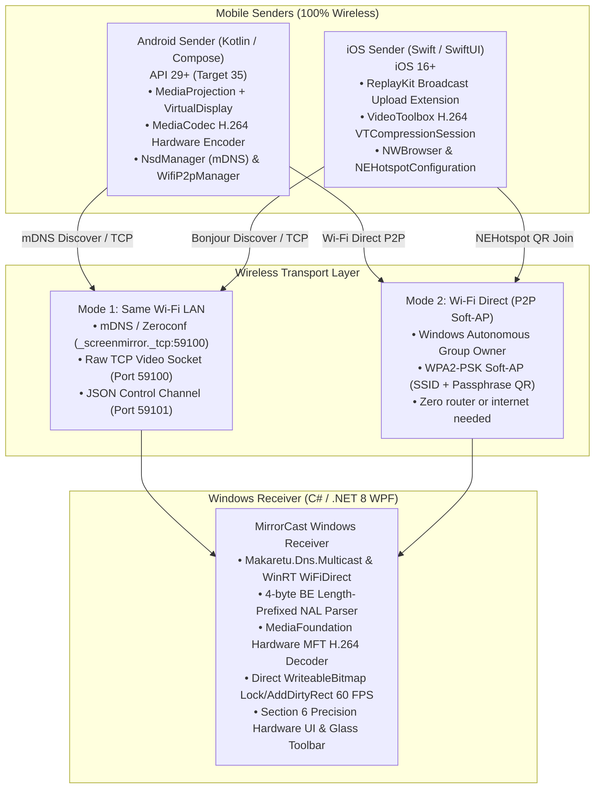

# MirrorCast — Production-Quality Screen Mirroring (iOS / Android → Windows)

> **100% Wireless, Zero-Latency, Zero-Configuration Screen Mirroring Desktop Client & Mobile Senders**

MirrorCast is an ultra-low latency, peer-to-peer screen streaming suite that mirrors displays from iOS and Android devices directly to a Windows desktop client over Wi-Fi without cables, cloud relays, or third-party proprietary services.

---

## 1. System Architecture



---

## 2. Key Capabilities & Specifications

| Feature | Specification |
|---|---|
| **Wireless Modes** | **Mode 1:** Standard Wi-Fi LAN (Zero-Config mDNS / Bonjour)<br>**Mode 2:** Wi-Fi Direct Autonomous Group Owner (No Router Needed) |
| **Video Codec** | H.264 Baseline Profile (AVC), 4-byte big-endian length-prefixed NAL units |
| **Frame Rates** | Up to 60 FPS capped with dynamic PTS smoothing |
| **Latency Target** | < 100 ms glass-to-glass over standard 5 GHz 802.11ac/ax Wi-Fi |
| **Resolutions** | 720p (`1280×720`), 1080p (`1920×1080`), or Source Device Native |
| **Audio** | Stretch AAC-LC parallel streaming channel |
| **Control Channel** | Port 59101: 2-second keep-alive ping/pong, dynamic resolution changes, pause/resume |
| **Design Language** | Strict Section 6 Precision Hardware UI (pure black `#000000`, silver hierarchy, glass floating toolbar, zero loading spinners) |

---

## 3. Project Directory Map

```
ScreenMirror/
├── PROTOCOL.md                  # Complete wire protocol specification (v1.0)
├── LICENSE                      # MIT Open Source License
├── .gitignore                   # Multi-platform gitignore (.NET, Android, iOS)
├── build-windows.ps1            # Automated Windows build script
├── build-android.ps1            # Automated Android build script
├── README.md                    # System architecture and deployment guide
│
├── WindowsReceiver/             # C# / .NET 8 WPF Desktop Client
│   ├── WindowsReceiver.csproj   # Targets net8.0-windows10.0.22621.0
│   ├── app.manifest             # PerMonitorV2 DPI awareness & WinRT compatibility
│   ├── App.xaml / App.xaml.cs   # Dark theme resource tokens & Serilog setup
│   ├── MainWindow.xaml / .cs    # Custom borderless chrome, tabs & video viewport
│   ├── Network/
│   │   ├── MdnsAdvertiser.cs    # mDNS responder for _screenmirror._tcp
│   │   ├── WiFiDirectService.cs # Autonomous Group Owner via WinRT WiFiDirect
│   │   ├── TcpStreamServer.cs   # Port 59100 video server & JSON handshake
│   │   └── ControlSocketServer.cs # Port 59101 control & keepalive channel
│   ├── Video/
│   │   ├── NalUnitParser.cs     # 4-byte BE length parser (SPS, PPS, IDR, Non-IDR)
│   │   ├── MediaFoundationNative.cs # Win32 COM MFT interop
│   │   ├── H264Decoder.cs       # Hardware MFT decoder with YUV-to-BGRA32 SIMD
│   │   ├── FrameRenderer.cs     # High-speed WriteableBitmap BackBuffer renderer
│   │   └── FpsTracker.cs        # 1.0s rolling frame rate metrics
│   ├── UI/
│   │   ├── Controls/            # GlassToolbar, PulsingDot
│   │   ├── Converters/          # FpsToBrushConverter, BooleanToVisibilityConverter
│   │   └── TrayIconManager.cs   # System tray integration
│   └── Tests/
│       └── NalUnitParserTests.cs # Unit test suite for NAL parsing & corruption
│
├── AndroidSender/               # Kotlin / Jetpack Compose Android Client
│   ├── build.gradle.kts         # Root Gradle build script
│   ├── settings.gradle.kts      # Project settings
│   ├── gradle.properties        # Kotlin 2.0 & JVM args
│   └── app/
│       ├── build.gradle.kts     # Compose BOM, Target SDK 35, Min SDK 29
│       └── src/main/
│           ├── AndroidManifest.xml # MediaProjection foreground service & permissions
│           ├── java/com/mirrorcast/sender/
│           │   ├── MainActivity.kt # Entry point & permission requests
│           │   ├── capture/
│           │   │   ├── ScreenCaptureService.kt # Foreground service coordinator
│           │   │   ├── MediaEncoder.kt         # Hardware MediaCodec H.264 encoder
│           │   │   ├── NalParser.kt            # NAL extraction & 4-byte BE framing
│           │   │   └── RotationWatcher.kt      # Dynamic orientation change handling
│           │   ├── discovery/
│           │   │   ├── NsdDiscoveryManager.kt  # Android NSD mDNS discovery
│           │   │   └── WifiDirectManager.kt    # WifiP2pManager Wi-Fi Direct client
│           │   ├── network/
│           │   │   ├── StreamingClient.kt      # TCP socket client & handshake
│           │   │   └── ControlChannelClient.kt # Port 59101 keepalive ping/pong
│           │   └── ui/
│           │       ├── components/             # PillSegmentedControl, ReceiverCard, PulsingDot
│           │       ├── screens/                # HomeScreen, StreamingScreen, SettingsDialog
│           │       └── theme/                  # Exact Section 6 Color & Typography tokens
│           └── res/                            # Vector drawables & theme XMLs
│
├── iOSSender/                   # Swift / SwiftUI Xcode Project
│   ├── MirrorCast.xcodeproj/    # Dual-target Xcode project configuration
│   ├── XCODE_SETUP.md           # Step-by-step macOS & Xcode deployment guide
│   ├── MirrorCast/              # Main iOS Application Target
│   │   ├── App/                 # MirrorCastApp.swift, AppState.swift
│   │   ├── Core/Networking/     # BonjourDiscoveryManager, HotspotManager, StreamingClient
│   │   ├── Core/Theme/          # ColorTheme.swift, Typography.swift, CustomSlider
│   │   ├── Views/               # HomeView, StreamingView, SettingsView, QRCodeScannerView
│   │   └── Resources/           # Info.plist, MirrorCast.entitlements
│   └── MirrorCastBroadcast/     # Broadcast Upload Extension Target
│       ├── SampleHandler.swift  # RPBroadcastSampleHandler entry point
│       ├── VideoEncoder.swift   # VTCompressionSession hardware H.264 encoder
│       └── BroadcastStreamClient.swift # Direct NWConnection streaming to port 59100
│
└── TestHarness/                 # Standalone Integration Test Suite
    ├── TestHarness.csproj       # .NET 8 Console Test Application
    └── Program.cs               # Full test suite: handshake, video stream, fuzzing
```

---

## 4. Build & Running Instructions

### 4.1 Windows Receiver (.NET 8 WPF)

#### Prerequisites:
- Windows 10 (Build 19041+) or Windows 11 (Recommended)
- .NET 8.0 SDK or .NET 8.0 Desktop Runtime

#### Automated Build:
Open PowerShell in the project directory:
```powershell
.\build-windows.ps1 -Configuration Release
```

To run immediately after building:
```powershell
.\build-windows.ps1 -RunAfterBuild
```

#### Self-Contained Deployment (Zero Dependencies):
```powershell
.\build-windows.ps1 -SelfContained -Configuration Release
```
This produces a single portable executable in `WindowsReceiver\bin\Release\publish\MirrorCastReceiver.exe`.

---

### 4.2 Android Sender (Kotlin / Compose)

#### Prerequisites:
- Android Studio Ladybug / Koala or newer
- JDK 17 or JDK 21
- Android device running Android 10 (API 29) to Android 15 (API 35)

#### Build via Gradle:
```powershell
.\build-android.ps1 -BuildType Debug
```
To build and install directly to a connected USB/Wi-Fi adb device:
```powershell
.\build-android.ps1 -BuildType Debug -InstallOnDevice
```
Or open the `AndroidSender` directory directly in **Android Studio** and click **Run**.

---

### 4.3 iOS Sender (Swift / SwiftUI)

#### Prerequisites:
- macOS Sonoma (14.0+) or Sequoia (15.0+)
- Xcode 15.0+ or Xcode 16.0+
- Physical iPhone or iPad running iOS 16.0+

#### Setup & Deployment Steps:
1. Transfer the `iOSSender` directory to a Mac.
2. Double-click `MirrorCast.xcodeproj` to open in Xcode.
3. In **Signing & Capabilities**, select your Apple Developer Team for both targets (`MirrorCast` and `MirrorCastBroadcast`).
4. Ensure App Group `group.com.mirrorcast.shared` is selected on both targets.
5. Select your connected iPhone in the device selector and press `Cmd + R` to build and deploy.
6. Detailed walkthrough available in [`iOSSender/XCODE_SETUP.md`](file:///C:/Users/moody/.gemini/antigravity/scratch/ScreenMirror/iOSSender/XCODE_SETUP.md).

---

### 4.4 Automated Test Harness & Verification

To verify that the receiver handles handshakes, streams, and edge cases correctly:

1. Launch the Windows Receiver app.
2. In another terminal, run:
```powershell
dotnet run --project TestHarness\TestHarness.csproj 127.0.0.1
```
The test harness will automatically run 5 comprehensive test suites:
- **Test 1:** Client Handshake protocol validation
- **Test 2:** Control Channel Keep-Alive ping/pong verification
- **Test 3:** Simulated 60 FPS H.264 stream (300 frames with SPS, PPS, IDR, slices)
- **Test 4:** Fuzzing with corrupt and oversized NAL units (>16 MB) to assert crash resilience
- **Test 5:** Rapid disconnect & reconnect session cycling

---

## 5. Wireless Connection Walkthrough

### Mode 1 — Same Wi-Fi Network (Default)
1. Ensure both the PC and phone are connected to the same Wi-Fi router (5 GHz recommended).
2. Launch **MirrorCast** on Windows. The app immediately displays:
   - PC local IP and port `59100`.
   - A QR code for instant pairing (`mirrorcast://<ip>:59100`).
   - A pulsing dot indicating active mDNS advertisement.
3. Open **MirrorCast** on Android or iOS.
4. The PC will appear automatically in the "AVAILABLE" list within 1–2 seconds.
5. Tap the PC card. The mobile device requests screen capture permission, connects to the TCP socket, and live streaming begins instantly.

### Mode 2 — Wi-Fi Direct (No Router / Traveling)
1. On Windows, switch to the **Wi-Fi Direct** tab.
2. The receiver initializes an Autonomous Group Owner and displays:
   - SSID (e.g. `DIRECT-MC-DESKTOP`)
   - WPA2 Passphrase
   - Wi-Fi credentials QR code
3. On Android: Switch the segmented toggle to "Wi-Fi Direct" and tap the discovered receiver.
4. On iOS: Tap **"Connect via QR Code"** and scan the QR code on the Windows screen. iOS joins the Wi-Fi Direct network automatically via `NEHotspotConfiguration`.
5. Tap Start Mirroring. Streaming proceeds identically over TCP port `59100`.

---

## 6. Troubleshooting FAQ

#### Q: The mobile app doesn't discover the Windows PC on Wi-Fi.
- **Firewall Check:** Windows Defender Firewall may block inbound connections on port 59100. Run this command in Administrator PowerShell:
  ```powershell
  New-NetFirewallRule -DisplayName "MirrorCast Video" -Direction Inbound -LocalPort 59100,59101 -Protocol TCP -Action Allow
  ```
- **AP Isolation:** Some public or guest Wi-Fi networks block device-to-device communication. Switch to **Wi-Fi Direct** mode to bypass router restrictions entirely.

#### Q: How do I exit Fullscreen on Windows?
- Press **F11** or **Escape**, or move the mouse to reveal the floating glass toolbar and click the fullscreen toggle icon.

#### Q: Where are screenshots saved?
- Screenshots taken from the floating toolbar are automatically saved as timestamped PNGs to your Windows **Desktop** (`MirrorCast_YYYYMMDD_HHmmss.png`).
